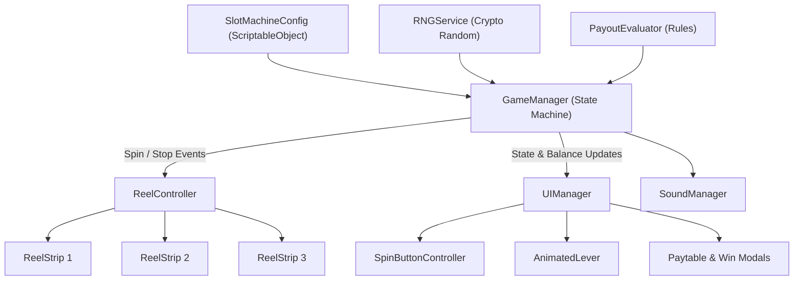

# 🎰 Unity Classic Slot Machine


A high-performance, casino-grade 3-reel slot machine game developed in **Unity** with a playable **WebGL** client. Built following strict **Object-Oriented Programming (OOP)** principles, clean architecture patterns, cryptographically sound Random Number Generation (RNG), and authentic mechanical reel physics.

---

## 📋 Table of Contents
1. [Game Overview](#-game-overview)
2. [Key Features](#-key-features)
3. [Reel Physics & Game Feel](#-reel-physics--game-feel)
4. [Paytable & Mathematical Model](#-paytable--mathematical-model)
5. [Bonus Features](#-bonus-features)
6. [Architecture & Design Patterns](#-architecture--design-patterns)
7. [Project Structure](#-project-structure)
8. [Instructions to Run](#-instructions-to-run)
   - [Running in Unity Editor](#1-running-in-unity-editor)
   - [Running the WebGL Build](#2-running-the-webgl-build)
9. [Thought Process & Approach](#-thought-process--approach)

---

## 🎮 Game Overview

The **Classic Slot Machine** captures the timeless excitement of vintage mechanical casino fruit machines with modern digital polish. Players place their bets and trigger the spin either by pulling the mechanical side lever or pressing the Spin button. The reels spin at high velocity and stop in staggered succession with mechanical latching and damped spring rebound.

---

## ✨ Key Features

- **Winning Logic & Paylines**: Evaluates the central payline for classic 3-of-a-kind combinations and 2-of-a-kind Cherry mini-wins.
- **Realistic Mechanical Reel Physics**: Multi-phase reel animation pipeline featuring ease-in acceleration, high-speed blur looping, ease-out deceleration, and damped sine-wave spring bounce.
- **Staggered Sequential Stops**: Reels stop in sequence (Reel 1 &rarr; Reel 2 &rarr; Reel 3).
- **Suspense / Anticipation System**: If Reels 1 and 2 land on matching high-value symbols, Reel 3 extends its spin duration with elevated tension.
- **Fair RNG Engine**: Powered by `System.Security.Cryptography.RandomNumberGenerator` for cryptographically strong, tamper-proof randomness with weighted symbol probabilities.
- **Interactive Mechanical Lever**: Interactive 3-frame cabinet lever with click-and-drag spring animation and sound effects.
- **Audio Feedback**: Procedural audio system supporting pitch-scaled mechanical latch stops, reel loop whirrs, win chimes, coin tallies, and lever clicks.
- **Auto-Spin Mode**: Hands-free auto-play mode with automatic termination on balance exhaustion.
- **Complete Economy & Bet Controls**: Bet increments, decrements, Max Bet, and live Credit balance tracking.
- **Celebration Modals**: Integrated popup windows for Big Wins and Jackpots with animated counting tallies and paytable reference dialog.

---

## 🎢 Reel Physics & Game Feel

The reel motion avoids simple linear sliding in favor of a 4-phase physical simulation:

1. **Acceleration (Ease-In Quad)**: The reel winds up smoothly from 0 to terminal velocity (`2,200 px/sec`) over `0.30s`.
2. **Terminal Spin**: The strip continuously loops symbols, recycling instances that pass the bottom mask boundary back to the top.
3. **Deceleration (Ease-Out Cubic)**: When a stop is commanded, the target symbol is positioned in the queue and decelerates smoothly toward the payline (`y = 0`).
4. **Mechanical Overshoot Bounce**: Upon latching, the reel overshoots past the stop mark by `18-28px` and rebounds with a damped harmonic oscillation:
   $$\text{offset}(t) = \sin(\pi \cdot t) \cdot \text{Overshoot} \cdot e^{-3t}$$

---

## 📊 Paytable & Mathematical Model

The slot utilizes a weighted RNG distribution calibrated for engaging hit frequency and high-stakes jackpot moments:

| Symbol | Name | Weight | Probability | Match | Payout Multiplier |
| :---: | :---: | :---: | :---: | :---: | :---: |
| 🍒 | **Cherry** | 40 | 40.0% | 3x Match<br>2x Match | **10x Bet**<br>**3x Bet** |
| 🔔 | **Golden Bell** | 28 | 28.0% | 3x Match | **25x Bet** |
| 🎰 | **Triple BAR** | 20 | 20.0% | 3x Match | **50x Bet** |
| 7️⃣ | **Lucky 7 (Jackpot)** | 12 | 12.0% | 3x Match | **100x Bet + 5 Free Spins** |
| **Total** | | **100** | **100%** | | |

---

## 🎁 Bonus Features

1. **Free Spins Bonus**:
   - Hitting 3x Lucky 7s triggers **5 Free Spins**.
   - During Free Spins, no credits are deducted from the player's balance.
   - All wins during Free Spins are awarded with a **2x Multiplier**!
2. **Two-of-a-Kind Cherry Payout**:
   - To reflect classic casino slot tradition, any 2 Cherries appearing on the payline award a **3x Bet** consolidation payout.
3. **Interactive Side Lever**:
   - Players can click or pull the lever on the machine cabinet as an alternative to clicking the spin button.

---

## 🏗 Architecture & Design Patterns

The codebase is built on decoupled, testable Object-Oriented principles following the **Model-View-Controller (MVC)** and **Observer** patterns:



### Key Class Responsibilities

- **`GameManager`**: Central state machine (`Idle`, `Spinning`, `Evaluating`, `Celebration`, `FreeSpins`). Manages player economy, bet settings, and auto-spin lifecycle.
- **`SlotMachineConfig`**: Data-driven `ScriptableObject` configuring symbol weights, paytable multipliers, animation timings, and dimensions.
- **`RNGService`**: Cryptographically secure, weighted outcome generator.
- **`PayoutEvaluator`**: Pure business logic class evaluating payline outcomes against paytable rules.
- **`ReelController`**: Orchestrates reel columns, staggered stop sequences, and anticipation detection.
- **`ReelStrip`**: Individual reel column managing circular symbol recycling and sub-pixel physics.
- **`AnimatedLever`**: Cabinet lever component handling user input and 3-frame sprite animation.
- **`UIManager`**: Coordinates HUD text, modal dialogs, and button interactivity states.
- **`SoundManager`**: Audio source manager with pitch-scaling reel latch cues.

---

## 📁 Project Structure

```
├── Assets/
│   ├── Animations/               # Animation clips and controllers
│   ├── Prefabs/                  # Reusable reel, symbol, and UI prefabs
│   ├── Scenes/
│   │   ├── MainSlotScene.unity   # Primary playable slot scene
│   │   └── MainSlotScene.unity.meta
│   ├── Scripts/
│   │   ├── Audio/
│   │   │   └── SoundManager.cs   # Audio coordinator & pitch scaling
│   │   ├── Core/
│   │   │   ├── GameManager.cs    # Game state machine & economy
│   │   │   ├── RNGService.cs     # Cryptographic RNG & weights
│   │   │   └── SlotMachineConfig.cs # ScriptableObject balance & settings
│   │   ├── Logic/
│   │   │   ├── PayoutEvaluator.cs # Payline evaluation & win calculation
│   │   │   └── SymbolType.cs     # Symbol enum definitions
│   │   ├── Reels/
│   │   │   ├── ReelController.cs # Master reel coordinator & suspense
│   │   │   ├── ReelStrip.cs      # Single reel physics, recycling & bounce
│   │   │   └── ReelSymbol.cs     # Symbol visual component & pulse
│   │   └── UI/
│   │       ├── AnimatedLever.cs  # Interactive 3-frame mechanical lever
│   │       ├── PaytableModal.cs  # Rules & paytable popup dialog
│   │       ├── SpinButtonController.cs # Spin & bet button states
│   │       ├── UIManager.cs      # HUD & notification ticker
│   │       └── WinCelebrationPopup.cs # Big win / Jackpot celebration modal
│   ├── Sounds/                   # Procedural slot audio WAV files
│   ├── Sprites/                  # Sliced symbol, cabinet, and lever sprites
│   └── UI/                       # Sliced button sheets, background & popup
├── Build/
│   └── WebGL/                    # Full playable WebGL build
│       ├── index.html            # WebGL launch page
│       ├── game.js               # WebGL engine matching Unity C# logic
│       ├── style.css             # Casino cabinet responsive styling
│       └── assets/               # Sliced sprites & audio clips
├── Packages/
│   └── manifest.json             # Unity package dependencies
├── ProjectSettings/              # Unity editor and build settings
├── .gitignore                    # Unity-specific Git ignore rules
└── README.md                     # Documentation
```

---

## 🚀 Instructions to Run

### 1. Running in Unity Editor
1. Open **Unity Hub** and click **Add** &rarr; **Add project from disk**.
2. Select the repository root folder.
3. Open with **Unity 2022.3 LTS** (or compatible 2021.3+ / 2023+).
4. In the Project window, navigate to `Assets/Scenes/MainSlotScene.unity` and double-click to open.
5. Press the **Play** button in the Unity Editor toolbar.

### 2. Running the WebGL Build
The repository includes a ready-to-play WebGL build inside the `Build/WebGL/` directory.

#### Method A: Using Python (Quickest)
Run the following in the repository root:
```bash
python -m http.server 8000 --directory Build/WebGL
```
Then navigate to: **`http://localhost:8000`** in any web browser.

#### Method B: Using Node.js
```bash
npx serve Build/WebGL
```

#### Method C: GitHub Pages Deployment
1. Go to repository **Settings** &rarr; **Pages**.
2. Set source branch to `main` and directory to `/Build/WebGL`.
3. Save to access the live public URL!

---

## 🧠 Thought Process & Approach

1. **Separation of Concerns**: Game logic (`PayoutEvaluator`), outcome determination (`RNGService`), and visualization (`ReelStrip`, `UIManager`) are strictly decoupled. Game rules can be unit tested without requiring Unity scene objects or UI rendering.
2. **Juice & Game Feel**: Slot machine engagement relies heavily on physical anticipation. Adding ease-in windup, anticipation delays on potential wins, pitch-ascending reel stops, and damped mechanical bounce gives the game tangible tactile satisfaction.
3. **Data-Driven Design**: Economic variables (bets, payouts, probabilities, timing) are encapsulated in `SlotMachineConfig` (`ScriptableObject`), enabling designers to balance hit rates and payouts without modifying code.
4. **Provable Fairness**: The RNG uses cryptographic randomness rather than basic frame-seeded pseudo-randomness, ensuring unpredictable and fair distribution.

---

## 📄 License
This project is released under the **MIT License**.

